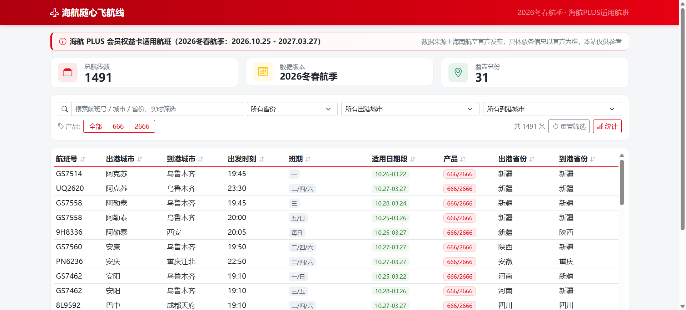

# 海航随心飞航线展示系统

本项目用于展示「海航 PLUS 会员权益卡」适用航线列表，提供筛选、搜索、排序、统计和站点通知等功能。

**部署方式：纯静态站点 + Vercel 托管（无后端、无数据库）**



## 功能概览

### 航线查询（首页 · 航线查询标签页）
- 航线列表展示：航班号、出港/到港城市、出发时刻、班期（自动转为星期显示）、适用日期段、产品、省份
- 筛选与搜索：
  - 按省份、出港城市、到港城市筛选
  - 产品筛选（666 / 2666，按适用产品 token 精确匹配）
  - 关键字实时搜索（航班号、城市、省份，200ms 防抖）
- 表头点击排序（升序/降序切换）
- 统计信息：总航线数、数据版本、覆盖省份数、各省份航线分布
- 站点通知弹窗：新数据上线等公告，同一版本仅自动弹一次，可点导航栏铃铛重看

### 行程规划（首页 · 行程规划标签页）
- 与航线查询同页，顶部标签切换，无需跳转；首次切换到该标签时才加载数据（懒加载）
- 旧地址 `trip-planner.html` 保留为跳转页，自动转到 `index.html#planner`
- 多航段串联规划（如 北京 → 西安 → 海口 → 北京），新航段自动继承上一段目的地、日期顺延一天，支持一键闭环
- 城市可搜索选择（输入名称过滤、键盘上下/回车），产品 666/2666 切换，行程自动存本地草稿
- 按所选日期核对班期与适用日期段：当天有班绿色高亮，当天无班/超出适用期明确标注
- 无直飞智能推荐：
  - 同区域可直飞机场（同城多机场优先，如北京首都/大兴），点击即可替换
  - 单中转方案（A→C→B 交集计算），按日期标注"当天可中转/次日抵达可行/班期需自行核对"并展示两程航班
- 海航随心飞单次行程限 3 个航段，超出时黄色提示但不禁止规划

- 全部静态资源本地化（Bootstrap / 图标字体），无 CDN 依赖

## 数据更新方法（推荐）

官方发布新航季 Excel 后，将文件放入项目根目录，执行：

```bash
python convert_excel.py "海航PLUS适用航班26冬春航线_A-Z排序版.xlsx"
```

- 自动读取全部工作表、按行去重、转换产品字段、映射省份
- 生成/覆盖 `hainan_airlines_data.json`
- 城市未匹配省份时会在控制台提示，需在 `convert_excel.py` 的 `PROVINCE_MAPPING` 中补充
- 不指定文件名时自动使用目录下最新的 `.xlsx`

### 发布站点通知

通知无需后台或数据库，直接编辑 `notice.json` 即可：

```json
{
  "enabled": true,
  "id": "notice-2026-1010",
  "title": "2026冬春航季数据已上线",
  "content": "通知正文...",
  "signature": "海南海航航空销售有限公司\n2026年10月10日",
  "publish_date": "2026-10-10"
}
```

- `id` 变更后，所有访问者会重新收到一次弹窗（已读记录存于浏览器 localStorage）
- `enabled` 设为 `false` 可下线通知
- `signature` 为可选落款，填写后按正式行文右对齐展示（`\n` 可换行），不填则不显示
- title 在弹窗标题栏展示，content 支持 `\n` 分段
- 提交推送到 GitHub 后，Vercel 自动重新部署生效

## 快速部署到 Vercel

1. 将本项目推送到你的 GitHub 仓库
2. 访问 [vercel.com](https://vercel.com) 并登录（可用 GitHub 账号）
3. 点击 **Add New Project**，选择你的 GitHub 仓库
4. 保持默认配置（纯静态，无需构建命令），点击 **Deploy**
5. 部署完成后，Vercel 会给你一个域名（如 `your-project.vercel.app`）

## 本地开发

### 转换数据（如需更新数据）

```bash
pip install openpyxl
python convert_excel.py
```

### 预览页面

```bash
python -m http.server 8000
```

然后访问 `http://localhost:8000`

## 目录结构

- `index.html` - 主页面（「航线查询」「行程规划」两个标签页，含通知弹窗）
- `app.js` - 航线查询逻辑（筛选、搜索、排序、分页、通知）
- `trip-planner.html` - 旧行程规划地址，保留为跳转页（自动转到 `index.html#planner`）
- `trip-planner.js` - 行程规划逻辑（多段串联、班期核对、同区域机场与中转推荐）
- `notice.json` - 站点通知配置（编辑即发布）
- `convert_excel.py` - Excel → JSON 数据转换工具
- `hainan_airlines_data.json` - 航线数据（查询页与规划页共用）
- `vendor/` - 本地化的 Bootstrap CSS/JS 与图标字体
- `crawler.py` - 旧版官方页面抓取脚本（可选保留，当前数据以 Excel 转换为准）
- `.github/workflows/crawl.yml` - 旧版定时抓取任务（可选）

## 数据来源

- 当前数据：海南航空官方发布的「海航PLUS适用航班26冬春航线」，适用日期 2026.10.25 - 2027.03.27，共 1491 条航线
- 页面顶部「适用航班日期」在 `index.html` 的信息条中维护

## 注意事项

- 本项目仅用于航线信息参考，具体票务与适用规则以海南航空官方为准
- 原始 Excel 文件与本地管理文档不入版本库（见 `.gitignore`）

## 技术栈

- **前端**：原生 HTML + JavaScript + Bootstrap 5（资源全部本地化）
- **数据转换**：Python + openpyxl
- **部署**：Vercel（纯静态托管，无后端、无数据库）
